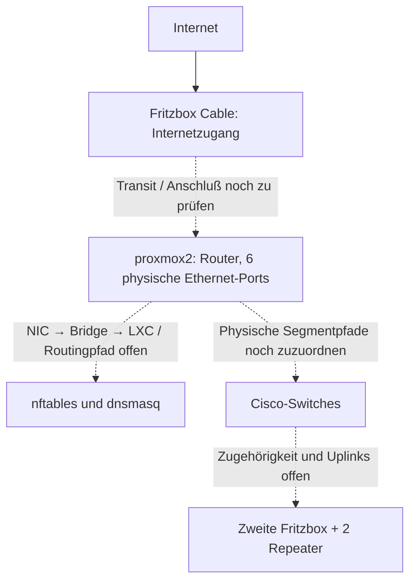

# Architektur und Beleglage

Stand: 1. November 2026. Diese Datei beschreibt Ausgangslage und Zielrichtung,
nicht einen bereits geprüften Umbau. Das [Inventar](../inventory/infrastruktur.json)
enthält die strukturierten Angaben.

## Vorgaben des Betreibers

- Proxmox mit LXC; dnsmasq für Netzdienste und nftables für die Firewall.
- Programmierbare Cisco-Switches.
- `proxmox2` dient als Router und besitzt sechs physische Ethernet-Ports.
- Netzwerksegmentierung ohne VLANs.
- Internet über Fritzbox Cable; eine weitere Fritzbox ist Teil des WLAN-Mesh.
- Zwei Fritz-Repeater 1200 sind vorhanden; die Fritzboxen sind eine 6670 Cable
  und eine 7530 AX. Mesh-Master, Uplinks und Gastnetzanbindung sind noch offen.
- Vodafone-Dual-Stack mit fester IPv4 `109.91.25.25` und laut Betreiber statischem
  IPv6-Präfix `2a02:908:c250:9d00::/59`. Die angezeigte Anschlußadresse
  `2a02:8070:a00::3e6a` ist davon getrennt zu betrachten.
- Eigene Domain `jaylab.org`; Zugriff auf `dfderp.jaylab.org` über `cloudflared`.

Belege, Anbieter-DNS-Server und die Verbesserungsplanung stehen unter
[Internet, Domain und Tunnel](INTERNET-DOMAIN-TUNNEL.md). Das `/59` bietet
32 `/64`-Netze; seine tatsächliche Weitergabe an `proxmox2` und die Zuordnung
zu den physischen Segmenten sind noch nicht geprüft. Bestehende ULA-Adressen
werden durch diese Betreiberangabe nicht ersetzt.

## Logischer Zusammenhang, noch kein Verkabelungsplan

Gestrichelte Kanten sind zu prüfende Beziehungen, keine bestätigten Kabel.
Aus der Routerrolle des Hosts folgt nicht, daß nftables im Host statt im LXC läuft.

## Ergänzter Live-Stand vom 1. November 2026

Die lesende Aufnahme für [U01](ERSTER-UEBERARBEITUNGSSCHRITT.md) belegt
`enp1s0` bis `enp6s0` auf `proxmox2` jeweils an `vmbr0` bis `vmbr5` und die
zugehörigen Router-/DNS-LXC-Anschlüsse. Diese Zuordnung wurde gemessen und
nicht aus gleichen Namen abgeleitet. Der Host und CT 101 leiten selbst nicht
auf IP-Ebene weiter; CT 103 hat IPv4-/IPv6-Weiterleitung eingeschaltet.
Seine IPv4-Default-Route führt über General zu `192.168.20.5`.

CT 103 filtert im aufgenommenen Netzraum keine Eingänge oder Weiterleitungen;
der offene Regelsatz ist auch persistent. Auf dem Proxmox-Host sind dagegen
IPv4-/IPv6-Hostfilter aktiv. CT 101 lernt denselben öffentlichen `/64` auf
fünf Schnittstellen, und eine gemeinsame Router-MAC wird über alle sechs
physischen NICs gelernt. Die externen Grenzen sind deshalb weiterhin ungeklärt.
Der obige Zusammenhang bleibt ein schematischer, kein bestätigter Kabelplan.

Anschließend wurden die falsche IPv6-Standardrouterrolle des DNS-LXC und seine
IPv6-DNS-Ankündigungen berichtigt. Der Betreiber bestätigt wieder funktionierende
Amazon-Music-Suche und Netflix im WLAN `papalapap`. Abnahme und verbleibende
Routenfragen stehen im [IPv6-Protokoll](IPV6-AMAZON-MUSIC.md). U01 wurde zugunsten
dieser Fehlerbehebung zurückgestellt.

## Dateibestand

`router/dnsmasq/dnsmasq.conf` beschreibt sechs logische Schnittstellen `enp1s0`
bis `enp6s0` für Admin, General, Familie, IoT, Media und Gäste. Diese Namen
beweisen keine Zuordnung zu den physischen Ports des Proxmox-Hosts.
Als Gateways sind `192.168.<Segment>.3`, als DNS-Adressen `.6` eingetragen.
Der verwendete ULA-Präfix im Konfigurationsbestand ist `fd38:21a1:1b97::/48`.

`router/nftables/nftables.nft` enthält NAT über `enp2s0`, Fritzbox-Ziele
`192.168.20.4` und `.5` sowie ältere WAN-, WLAN- und DMZ-Angaben. Die
Hosts-Datei bezeichnet `.5` als Kabel-Fritzbox und `.4` als alte DSL-Fritzbox.
Dies sind Hinweise auf den Bestand, keine Bestätigung des aktuellen Betriebsmodus.
Insbesondere ist General nicht ohne Prüfung als getrenntes WAN-Transitnetz anzusehen.

Die Adressen `proxmox2-2` bis `proxmox2-6` werden nicht als zusätzliche physische
Nodes gezählt, solange ihre Funktion nicht festgestellt ist.

## Entscheidende offene Fragen

1. Welche NIC mit welcher MAC und welchem Kabel führt zu welchem Gegenport?
   Welche Bridges und LXC-Schnittstellen hängen daran? Liegen die Routerdienste
   auf `proxmox2`, in einem LXC oder verteilt?
2. Wie passen sechs physische Ports, sechs konfigurierte LAN-Segmente und der
   Internet-Uplink zusammen? Wird ein Segment zugleich als Transit genutzt?
   Sind alle Segmente tatsächlich verkabelt? Erst die Aufnahme entscheidet.
3. Können Cisco-Switches im vorhandenen Modell und Betriebsmodus die gewünschten
   physischen Segmentpfade wirklich getrennt halten? Mehrere ungetaggte Netze
   auf demselben gemeinsamen Switch-Fabric oder Uplink nicht als isoliert annehmen.
   Ohne VLANs sind getrennte Broadcast-Domänen physisch oder durch nachgewiesene
   Geräteeigenschaften sicherzustellen. Ein nicht umsetzbarer Entwurf ist als
   Grenze auszuweisen; keine verdeckte VLAN-Lösung einführen.
4. Welches Fritz-Gerät stellt DHCP, DNS, IPv6-RA und die Standardroute bereit?
   Besteht ein Weg von WLAN-Geräten direkt zur Kabel-Fritzbox an der Firewall vorbei?
5. Welche Fritzbox ist Mesh-Master, wie sind die zwei Repeater angebunden, und
   welche SSID liegt tatsächlich in welcher Broadcast-Domäne? DHCP-Gerätenamen
   mit mehreren Funk-/Ethernet-MACs beweisen keine zusätzlichen Repeater.
6. Welche IPv6-Präfixe, Default-Router und Filter sind tatsächlich aktiv?
   Welche Pfade bleiben bei Ausfall von `proxmox2`, dnsmasq oder Cable nutzbar?
7. Welchen Teil des öffentlichen `/59` nutzt die Fritzbox, welchen delegiert
   oder routet sie zum nachgelagerten Router? Wie funktionieren Rückroute,
   RA, Präfixerneuerung und IPv6-Filterung je Zone?
8. Welcher Connector und welcher interne Dienst bedienen `dfderp.jaylab.org`?
   Welche DNS-, TLS- und Anmelderegeln gelten, und bestehen direkte Nebenpfade
   über IPv4, IPv6 oder internes DNS?

## Zielrichtung

Zwischen Vertrauenszonen erfolgt Verkehr über den nachgewiesenen Router- und
Firewallpfad. Gemeinsame Bridges, Switchverbindungen, WLAN-Uplinks oder zweite
Default-Router dürfen die Grenze nicht umgehen. Bestehende Subnetze zunächst
erhalten und ihre Notwendigkeit prüfen, bevor Adressen oder Geräte umziehen.

Proxmox-Verwaltung bleibt vom Gast-/IoT-Zugriff getrennt. Notzugang,
Startreihenfolge und Wiederherstellung dürfen nicht ausschließlich von demselben
Router-LXC, demselben DNS oder demselben Switchpfad abhängen, der geändert wird.

Proxmox-Netzwerkänderungen nach der Dokumentation der tatsächlich installierten
Version planen; versions- oder modellspezifische Aussagen erst nach deren Ermittlung treffen.
